<p align="center">
  <picture>
    <source media="(prefers-color-scheme: dark)" srcset="docs/readme/banner-dark.svg">
    
  </picture>
</p>

<p align="center">
  <a href="skills/neuer-kunde/CHANGELOG.md"></a>
  &nbsp;
  <a href="LICENSE"></a>
  &nbsp;
  <a href="#install"></a>
  &nbsp;
  <a href="#install"></a>
  &nbsp;
  <a href="skills/neuer-kunde/SKILL.md"></a>
</p>

**/neuer-kunde** ("new client") is an Agent Skill that turns Claude into a small web studio. You type `/neuer-kunde`, answer a few rounds of questions, and Claude sets up the project folder, builds the site with real motion and 3D, tests it until it is green, writes the contract and the invoice, and keeps your books. After every project it learns from your corrections and gets better, but only if the new version passes its tests.

It is not a template and it has no house look. It is the **process** that three real websites went through, with every correction the client and the designer made along the way written down as a rule.

<p align="center">
  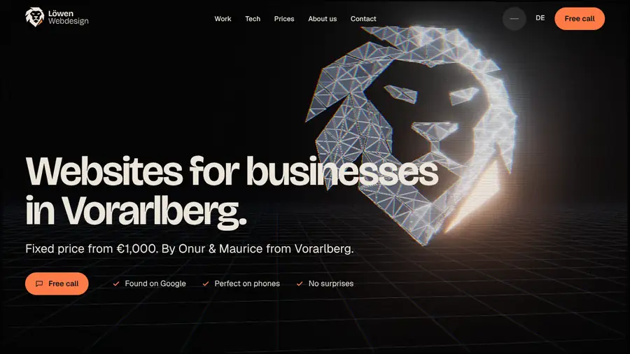
  <br>
  <sub>Löwen Webdesign, built with this skill. The logo is the 3D world: the lion opens, you fly through it, and the same facets rebuild themselves for every section.</sub>
</p>

<details>
<summary><b>Contents</b></summary>

- [What it built](#what-it-built)
- [What it does](#what-it-does)
- [How a project runs](#how-a-project-runs)
- [Quality gates](#quality-gates)
- [Install](#install)
- [Commands](#commands)
- [Your project folder](#your-project-folder)
- [Rules it learned the hard way](#rules-it-learned-the-hard-way)
- [It improves itself, with tests](#it-improves-itself-with-tests)
- [Repository layout](#repository-layout)
- [Credits](#credits)

</details>

## What it built

Every image below is a real screenshot or recording. Nothing is a mockup.

### Löwen Webdesign, the agency site

<table>
  <tr>
    <td width="50%">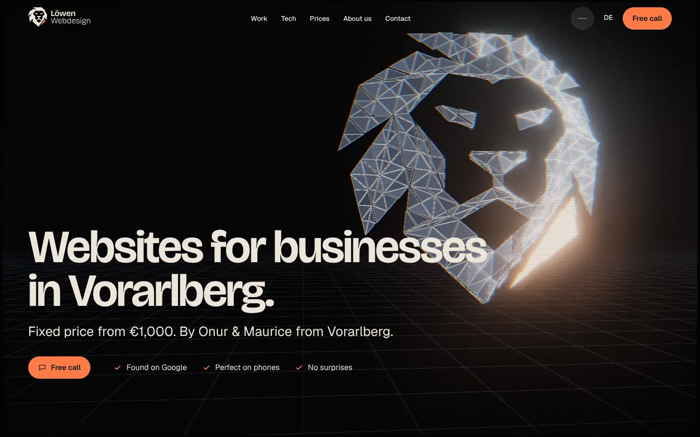<br><sub><b>Hero.</b> The logo as a 3D world, the headline in the first frame.</sub></td>
    <td width="50%">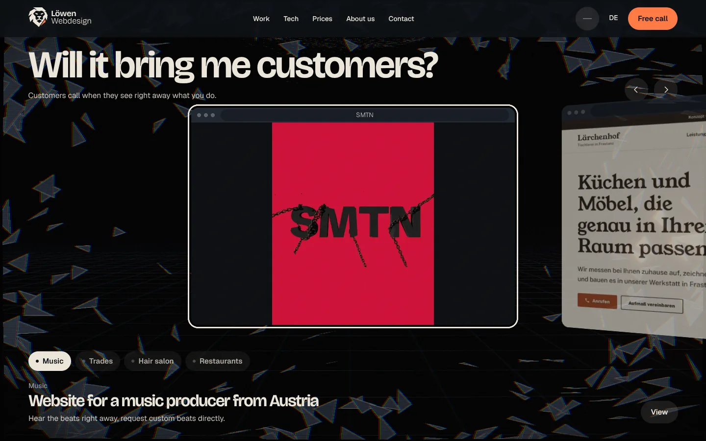<br><sub><b>Work.</b> Real sites in browser windows on an arc, each with a short video loop.</sub></td>
  </tr>
  <tr>
    <td width="50%">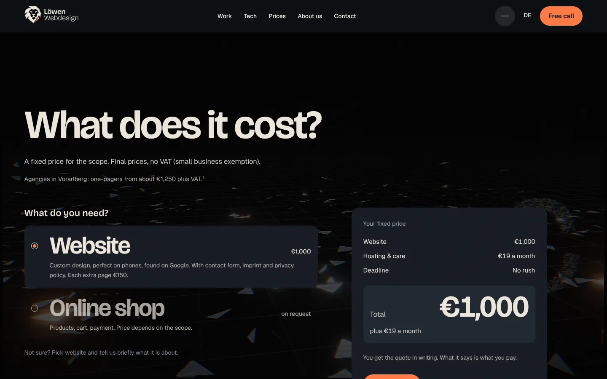<br><sub><b>Pricing.</b> A calculator with a fixed price, the receipt updates as you choose.</sub></td>
    <td width="50%">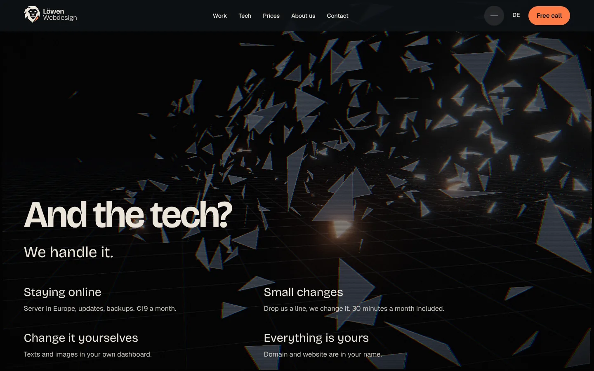<br><sub><b>Every heading is a customer's question.</b> Short answers, no jargon.</sub></td>
  </tr>
</table>

<table>
  <tr>
    <td width="34%" align="center">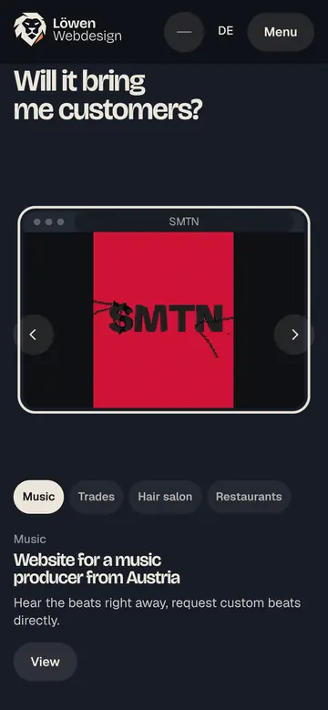<br><sub><b>Phone.</b> Swipe through the work with a finger.</sub></td>
    <td width="33%" align="center">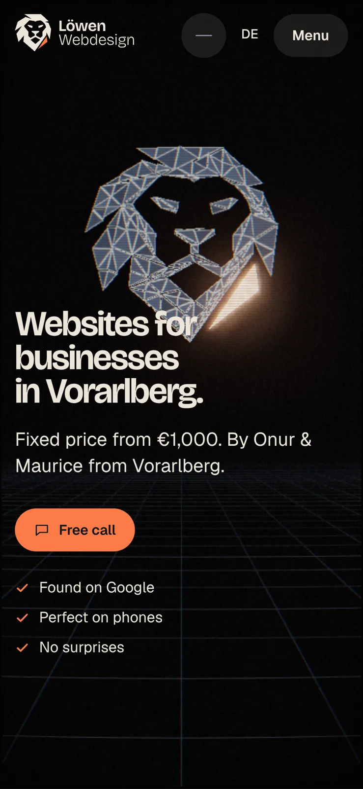<br><sub>The hero at 390 px.</sub></td>
    <td width="33%" align="center">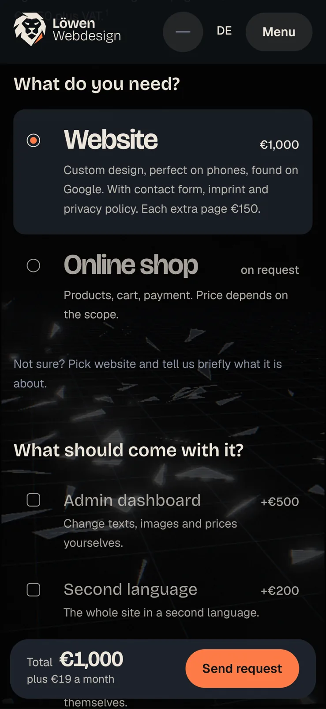<br><sub>Pricing with a fixed total bar.</sub></td>
  </tr>
</table>

### Three concept sites for made-up businesses

Built from a one-line brief each, to show what the skill does for small local businesses. They are clearly labelled as concepts on the sites themselves. Each one has its own piece of motion that belongs to the trade.

<table>
  <tr>
    <td width="33%">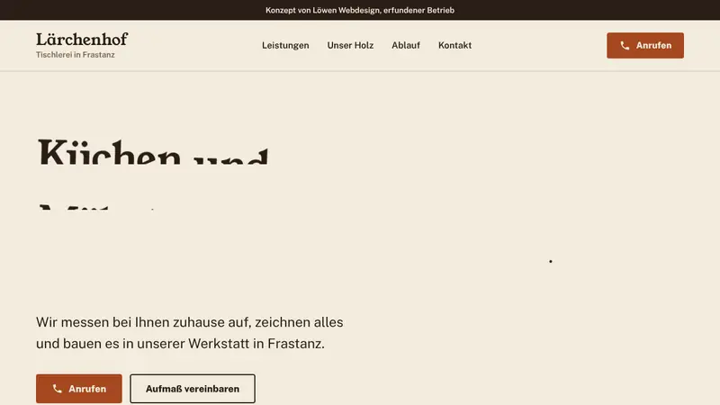<br><sub><b>Joinery.</b> The trunk grows ring by ring, the drawings draw themselves.</sub></td>
    <td width="33%">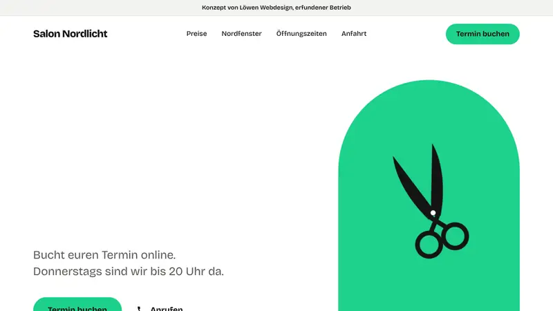<br><sub><b>Hair salon.</b> The scissors cut while you scroll.</sub></td>
    <td width="33%">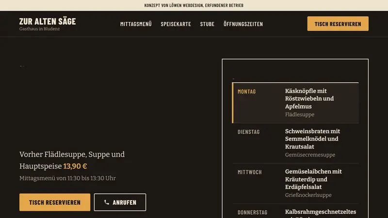<br><sub><b>Inn.</b> Today's lunch first, the saw spins up with your scroll.</sub></td>
  </tr>
</table>

### SMTN, a music producer (real client)

<p align="center">
  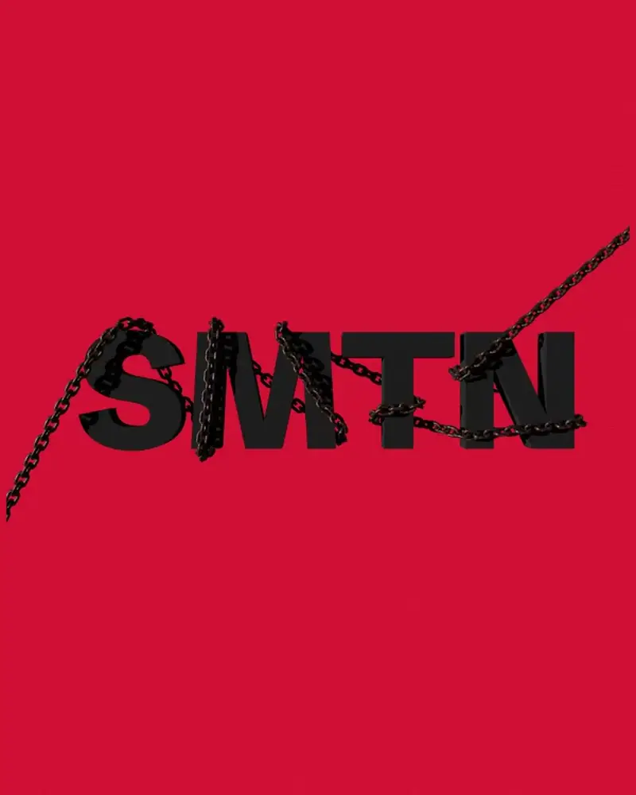
  <br>
  <sub>Brutalist and loud on purpose. The chains lock the beats away and break as you scroll. 61 rounds of changes went into this skill.</sub>
</p>

## What it does

| | |
| --- | --- |
| **Asks first, in the right order** | Five short rounds: who it is for, content and proof, direction (style, colours, fonts with live previews), leitmotif and 3D, tech and hosting. Answers that change everything (does money flow through the site?) come first. |
| **Never makes things up** | No invented clients, prices, testimonials or numbers. What is missing is marked as open and stays hidden on the site until you fill it in. |
| **Sets up the business side** | A project folder per client, a finance workbook with formulas (projects, income, expenses), contract and invoice from Word templates, consecutive invoice numbers, final invoices that subtract the deposit and pass on costs. |
| **Designs with a reason** | Five directions (raw brutalist, cinema night, quiet editorial, technical, warm craft), one leitmotif that carries the whole page, and the [Taste Skill](https://github.com/Leonxlnx/taste-skill) as a hard design gate. |
| **Builds real motion and 3D** | Scroll sequences, real-time scenes from Blender, or a world made from the logo itself. Light enough for phones, with a calm fallback when there is no graphics card. |
| **Tests until it is green** | Type checks, unit tests, Playwright end-to-end tests on desktop and phone, accessibility, Lighthouse, and four simulated customers with a click heatmap. |
| **Handles the boring parts** | Imprint and privacy policy for Austria, Germany or Switzerland, robots, sitemap, `llms.txt`, JSON-LD, a contact form that sends with one click, a phone preview link. |
| **Keeps notes** | Every round of changes gets a note: the wish in the client's words, what changed, what was tested, where the backup is. |

> [!NOTE]
> The skill's instructions are written in German, because the projects it came from were German-speaking. It talks to you in **your** language. Contract and invoice templates follow Austrian, German or Swiss rules and are templates, not legal advice.

## How a project runs

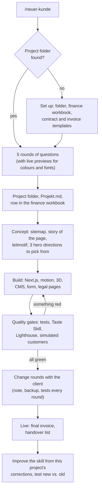

## Quality gates

Every round ends with the same checks, and the skill fixes what fails instead of only reporting it.

| Gate | What it checks |
| --- | --- |
| Basics | `tsc`, lint, unit tests, production build, no unused code, no secrets |
| [Taste Skill](https://github.com/Leonxlnx/taste-skill) | `lint.mjs` and `inspect.mjs` in a real browser at 1440, 768 and 390 px: no eyebrow labels, no glass, no gradients, one visible `h1`, nothing under 13 px |
| Playwright E2E | Every route, forms, menu, legal pages, back button, scrolling down **and** up like a human (mouse wheel, trackpad, thumb), with and without WebGL |
| Accessibility | axe on every route, no serious or critical issues |
| Lighthouse | Every route, phone and desktop, numbers into the round's note |
| Simulated customers | Four persona agents from the real target group look at screenshots of every section, say where they would click and why they would leave. The clicks become a heatmap. |

<p align="center">
  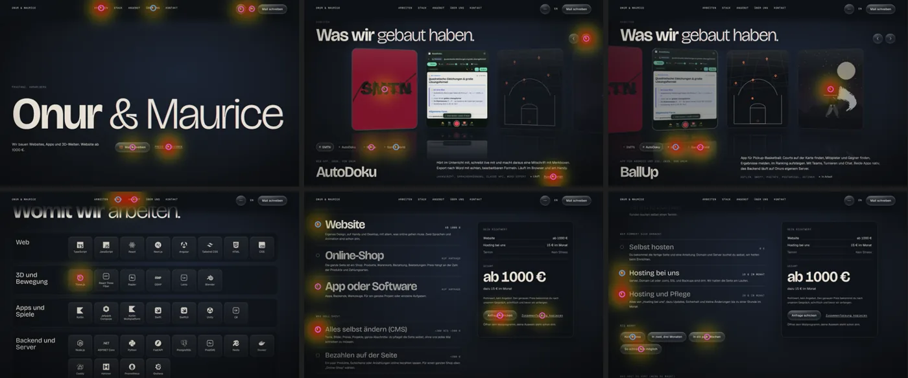
  <br>
  <sub>Clicks of four simulated customers on an earlier version of the Löwen site. They are assumptions, not real visitors, and the skill says so.</sub>
</p>

**Measured on the Löwen site** (Lighthouse, live, 6 Nov 2026), after a performance round the skill ran:

| | Phone | Desktop |
| --- | --- | --- |
| Performance, before | 59 | 61 |
| Performance, after | **95 to 96** | **100** |
| Accessibility, Best Practices, SEO | 100 | 100 |

The three concept sites score 99 to 100 on a phone. The Löwen site runs 126 end-to-end tests across desktop, phone, and both with real WebGL.

## Install

The skill needs **Python 3** with `openpyxl` and `python-docx` for the folder, workbook, contract and invoice. Building sites needs **Node 22+** and Chromium for Playwright. LibreOffice turns contracts and invoices into PDFs.

**Claude Code (plugin)**

```
/plugin marketplace add FreeOnur/neuer-kunde
/plugin install neuer-kunde@neuer-kunde
```

<details>
<summary><b>Other ways</b></summary>

**With the skills CLI**

```bash
npx skills add https://github.com/FreeOnur/neuer-kunde --skill neuer-kunde
```

**From a clone, linked instead of copied** (a `git pull` updates it)

```bash
git clone https://github.com/FreeOnur/neuer-kunde.git
cd neuer-kunde && ./install.sh
```

**Claude.ai**

1. Download this repository and zip the folder `skills/neuer-kunde` (the zip must contain the folder `neuer-kunde` with `SKILL.md` inside).
2. Open **Customize > Skills**, click **+**, then **Create skill > Upload a skill**, and pick the zip.

</details>

Then start a new session and type `/neuer-kunde`. On the first run it asks where your projects should live and sets that folder up. Nothing that is already there gets overwritten.

## Commands

| You type | What happens |
| --- | --- |
| `/neuer-kunde` | New project: questions, folder, concept, build, tests |
| `/neuer-kunde einrichten` | Set up (or repair) your projects folder |
| `/neuer-kunde weiter <project>` | Continue: reads the project notes, sums up where it stands, asks what is next |
| `/neuer-kunde prüfen <project>` | Only the quality round, with fixes. Works on sites built without this skill too |
| `/neuer-kunde geld <project> <text>` | Book money, e.g. "client paid the deposit" or "domain 15 €" |
| `/neuer-kunde vertrag <project>` | Contract from the template, as Word and PDF |
| `/neuer-kunde rechnung <project>` | Invoice with the next consecutive number |
| `/neuer-kunde fertig <project>` | Close the project and improve the skill from it |
| `/neuer-kunde verbessern` | Improve the skill from everything learned since the last version |

Plain sentences work too. "The bakery paid" books the payment, "write the invoice for Huber" writes it.

## Your project folder

```text
Websites/
├── Finanzdokumentation.xlsx   overview, projects, income, expenses (formulas stay intact)
├── Vertragvorlage.docx        contract template with {{PLACEHOLDERS}}
├── Rechnungsvorlage.docx      invoice template with {{PLACEHOLDERS}}
├── Prompt.txt                 a brief you can fill in instead of answering questions
├── _werkzeuge/                fill templates, book money, your details, settings
├── _skills/                   copies and versions of the skill, list of lessons
├── Kunden/<Client>/           Projekt.md, contract, invoices, receipts, files from the client, notes
└── Eigene Projekte/<Name>/    your own sites, same layout without a contract
```

<table>
  <tr>
    <td width="45%">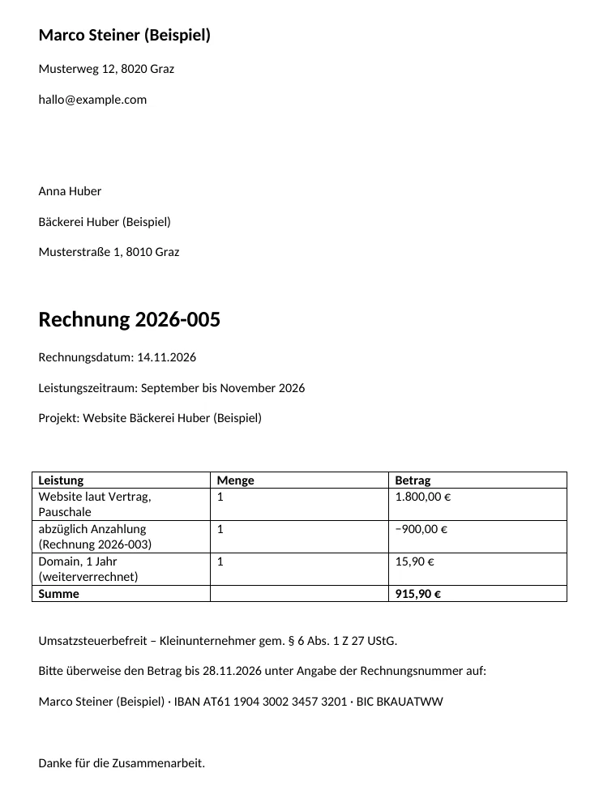</td>
    <td><b>A final invoice the skill writes</b> (example data). Always the same shape: the flat fee from the contract, the deposit subtracted with its invoice number, then every cost you paid for the client as its own line. The client sees how the total comes about.<br><br>The workbook gets a row with status <i>open</i> at the same moment, and <code>geld</code> sets it to <i>paid</i> with the date.</td>
  </tr>
</table>

## Rules it learned the hard way

The heart of the skill is a long list of rules, each one written after a real correction. A few of them:

- **Specific or gone.** Any sentence that could stand on a competitor's site gets more specific or gets cut.
- **Short from the first draft.** "Too much text" came up in round 17. Intro one sentence, points under 70 characters, headings two short lines, checked by a unit test.
- **Headings are the customer's questions.** "Will it bring me customers?", "What does it cost?", "How do we start?"
- **Show, don't claim.** "Original beats, no loop kits" was removed: "maybe he does use loop kits, we can't know that."
- **The leitmotif needs a meaning.** Chains that lock the beats away, a lion made of the same facets as the whole site. Decoration without meaning goes.
- **Nothing that blocks the first frame.** No curtain, no preloader. The headline is visible at once, the sound question is a small bar that blocks nothing.
- **Empty 3D stretches look broken.** All four simulated customers took an empty grey screen for a loading error, so every passage gets a line of text.
- **People photos: look at all of them first.** Cut out strangers, cardboard figures and foreign logos, or don't use the photo.

## It improves itself, with tests

After every project the skill reads its own notes, pulls out every correction that could happen again, and writes it into the right section. A new version only counts if it does at least as well as the old one on the test cases in [`testfaelle/`](skills/neuer-kunde/testfaelle), run side by side in the style of Anthropic's `skill-creator`.

That rule has already paid off: version 3 passed 20 of 20 checks where version 2 passed 19, and set up a stranger's folder in about 70 seconds instead of 437, without copying the author's own paths into it. Every version is listed in the [changelog](skills/neuer-kunde/CHANGELOG.md), and the previous one is kept in [`versionen/`](skills/neuer-kunde/versionen).

## Repository layout

```text
.claude-plugin/marketplace.json   Claude Code plugin marketplace entry
skills/neuer-kunde/
├── SKILL.md                      the skill (German)
├── CHANGELOG.md                  what changed per version and how it tested
├── scripts/                      set up the folder, fill templates, book money
├── testfaelle/                   test cases with example folders and graders
└── versionen/                    previous versions, unchanged
docs/readme/                      images for this page, and the scripts that made them
install.sh                        link the skill into ~/.claude/skills
```

The screenshots and recordings on this page come from [`docs/readme/capture.mjs`](docs/readme/capture.mjs) (Playwright against the real builds) and [`make-media.py`](docs/readme/make-media.py).

## Credits

- Built by [FreeOnur](https://github.com/FreeOnur) with Claude, out of three real projects: the SMTN site, a personal portfolio and the Löwen Webdesign agency site.
- The design gate is the [Taste Skill](https://github.com/Leonxlnx/taste-skill) by Leonxlnx (MIT).
- The joinery, the hair salon and the inn are made up. They exist only to show the work.

## License

[MIT](LICENSE)
